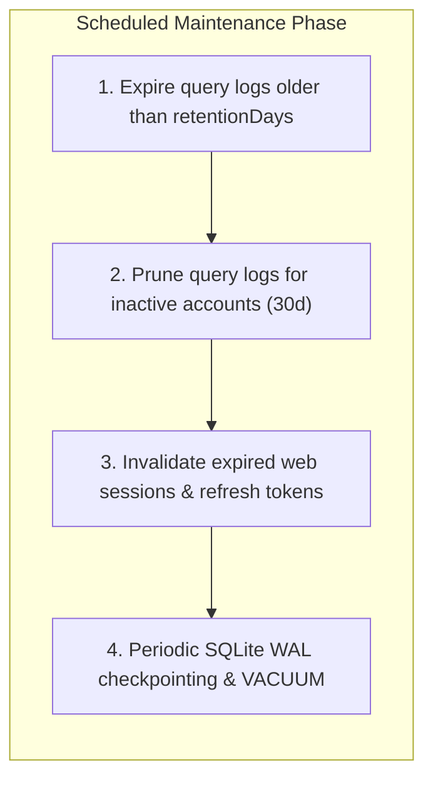

To balance auditability with user privacy and storage performance, DNS Worker incorporates an automated lifecycle and retention engine. This document covers query log retention rules, background compaction tasks, and maintenance environment variables.

---

## 1. Query Log Retention & Privacy Policies

### Maximum Retention Cap (`MAX_LOG_RETENTION_DAYS`)
Query log retention is capped by the administrator's `MAX_LOG_RETENTION_DAYS` setting (defaults to **30 days** in Serverless D1, and **360 days** in Serverfull mode).
- **Privacy Principle**: DNS resolution logs contain personal browsing trails. Configurable log retention allows operators to balance audit compliance requirements with privacy preservation.
- **Storage Efficiency**: Limiting log tables ensures database indices fit comfortably in RAM, preventing query degradation and storage exhaustion.

### 30-Day Inactivity Auto-Purge
To protect privacy and conserve disk space:
- If a profile has **no DNS resolution activity for 30 consecutive days**, its historical query logs are automatically pruned.
- **Configurations Preserved**: The user account, custom blocklists, allowlists, and profile routing keys remain intact. Only historical query log records are removed.

---

## 2. Background Task Automation

DNS Worker maintains database health through scheduled background tasks:

- **Cloudflare Workers Mode**: Executed via Cloudflare Cron Triggers (`scheduled(event, env, ctx)` handler).
- **Serverfull Node.js / Bun Mode**: Executed via background interval timers managed directly within the process.

---

## 3. High-Throughput Log Batcher Architecture

Inserting individual log rows for thousands of DNS queries per second would saturate database transaction locks. DNS Worker buffers logs in memory:

- Queries accumulate in an asynchronous memory queue.
- Logs are flushed in bulk transactions when either the batch size threshold (`LOG_BATCH_SIZE`) or timeout window (`LOG_FLUSH_INTERVAL_MS`) is met.
- In-memory buffers are protected against memory exhaustion using bounded queue limits.

---

---

## 4. Maintenance & Quotas: Serverless vs Serverfull

Because Cloudflare D1 imposes database storage and daily write quota limits (500 MB storage in the free tier, 100k daily write operations), retention caps and log budgets are calibrated differently between Serverless (`wrangler.toml`) and Serverfull (`.env.serverfull`).

| Maintenance Parameter | Serverless (`wrangler.toml`) | Serverfull (`.env.serverfull`) | Rationale & Constraint |
| :--- | :--- | :--- | :--- |
| **Admin Max Retention** (`MAX_LOG_RETENTION_DAYS`) | **30 Days** | **360 Days** | Protects D1 from storage exhaustion on Edge; permits long-term auditing on Serverfull. |
| **Admin Default Retention** (`DEFAULT_LOG_RETENTION_DAYS`) | **7 Days** | **180 Days** | High default storage allowance on local disks. |
| **Normal User Max Retention** (`NORMAL_USER_MAX_LOG_RETENTION_DAYS`) | **7 Days** | **30 Days** | Restricts non-admin user storage footprint. |
| **Normal User Default** (`NORMAL_USER_DEFAULT_LOG_RETENTION_DAYS`) | **1 Day** | **7 Days** | Minimal retention default for multi-tenant accounts. |
| **Max Log Rows per Profile** (`MAX_LOGS_PER_PROFILE`) | **500,000** | **5,000,000** | Circuit-breaker when query rates exceed deletion rate. |
| **Cleanup Batch Limit** (`LOG_CLEANUP_BATCH_LIMIT`) | `1000` rows/run | `1000` rows/run | Prevents database transaction timeouts during cron runs. |
| **Daily Deletion Budget** (`LOG_CLEANUP_DAILY_BUDGET`) | `20,000` rows/day | `20,000` rows/day | Conservatively preserves 80% of D1's 100k daily write quota. |
| **Account Inactivity Threshold** (`INACTIVITY_THRESHOLD_DAYS`) | `180` Days | `180` Days | Period before dormant accounts are considered abandoned (evaluated strictly by DNS resolution activity). |
| **Inactivity Log Purge** (`INACTIVE_LOG_PURGE_DAYS`) | **30 Days** | **30 Days** | Prunes historical query logs for 30d inactive accounts, preserving configurations and routing keys. |

---

## 5. Maintenance Environment Variables Reference

### Retention & Quota Variables

#### `MAX_LOG_RETENTION_DAYS` & `DEFAULT_LOG_RETENTION_DAYS`
- **Supported in**: Serverless & Serverfull
- **Defaults**:
  - `wrangler.toml`: Max `30`, Default `7`
  - `.env.serverfull`: Max `360`, Default `180`
- **Description**: Upper bound and default lifetime for query logs of administrator profiles.

#### `NORMAL_USER_MAX_LOG_RETENTION_DAYS` & `NORMAL_USER_DEFAULT_LOG_RETENTION_DAYS`
- **Supported in**: Serverless & Serverfull
- **Defaults**:
  - `wrangler.toml`: Max `7`, Default `1`
  - `.env.serverfull`: Max `30`, Default `7`
- **Description**: Storage quotas applied to standard non-administrator users.

#### `MAX_LOGS_PER_PROFILE`
- **Supported in**: Serverless & Serverfull
- **Defaults**: `500000` (Serverless) vs `5000000` (Serverfull)
- **Description**: Hard ceiling on total query rows preserved per profile. Protects database health during sustained query surges.

---

### Batching & Session Lifetimes

#### `LOG_CLEANUP_BATCH_LIMIT` & `LOG_CLEANUP_DAILY_BUDGET`
- **Defaults**: `1000` (Batch Limit) and `20000` (Daily Budget)
- **Description**: Regulates the deletion velocity during scheduled maintenance runs to ensure operations stay well within database transaction quotas.

#### `INACTIVITY_THRESHOLD_DAYS`
- **Supported in**: Serverless & Serverfull
- **Default**: `180` Days
- **Description**: Dormant account abandonment threshold for non-administrator accounts. Evaluated strictly by **DNS resolution activity** (`last_active_at`, fallback to account creation time `created_at` if no queries were ever recorded). Accounts with no DNS resolution traffic for this duration are permanently removed.

#### `INACTIVE_LOG_PURGE_DAYS`
- **Supported in**: Serverless & Serverfull
- **Default**: `30` Days
- **Description**: Inactivity log auto-purge threshold. Automatically purges query logs and pre-aggregated rollups for non-admin accounts that have had no DNS resolution traffic for this duration, freeing database storage. **Configurations, custom rules, access points, and routing keys are preserved intact.**

#### `DEFAULT_SESSION_EXPIRATION_MINUTES` & `OPTIONAL_SESSION_EXPIRATION_DAYS`
- **Defaults**: `1440` (24 Hours default session) and `7` (7 Days when "Remember Me" is checked)
- **Description**: Controls JWT and database authentication session lifetimes.

#### `ACCESS_TOKEN_EXPIRATION_MINUTES` & `RTR_GRACE_WINDOW_MS`
- **Defaults**: `1` minute (short-lived Access Token) and `15000` ms (15s Refresh Token Rotation concurrency grace window).
- **Description**: Zero-trust token rotation parameters preventing stale token reuse while avoiding unexpected multi-tab logouts.

#### `AUTO_VACUUM` & `SQLITE_JOURNAL_MODE` *(Serverfull Only)*
- **Defaults**: `WAL` (Write-Ahead Logging)
- **Description**: Direct SQLite engine flags in Serverfull mode for concurrent reads and resilient crash recovery.

---

## 6. Estimated Database I/O per 1,000 DNS Queries

The table below estimates the **database rows read and written per 1,000 incoming DNS requests** across common configuration and deployment scenarios (reflecting the `WITHOUT ROWID` `logs` schema, zero secondary indexes on `logs`, and hourly cron rollup aggregation).

> **Note on storage engine accounting:**
> - **Cloudflare D1 / Serverfull SQLite** supports `WITHOUT ROWID`, so `logs` uses a single clustered B-tree (**1 row written per log**), and `kem_keys` writes **3 rows per key** (clustered PK + 2 indexes).
> - **TursoDB (Limbo)** falls back to standard rowid tables (`WITHOUT ROWID` stripped during migration), so each row carries a rowid B-tree plus primary-key autoindex (**2 rows written per `logs` insert**, **4 rows written per `kem_keys` insert**).

| Scenario (per 1,000 DNS Queries) | Rows Read (Hot L1/L2 Cache) | Rows Read (Cold Isolates / Hourly Cron) | Rows Written (D1 / Serverfull SQLite) | Rows Written (TursoDB / Limbo) | Key Drivers |
| :--- | :--- | :--- | :--- | :--- | :--- |
| **Plaintext Logs (Full Logging)** | **~0 – 50** | **~1,200 – 6,000** | **~1,020 – 1,150** | **~2,020 – 2,150** | 1× `logs` insert per query + hourly Cron `aggregateHourlyRollups` scan & summary (`action`, `client`, `dest`, `domain`, `isp`). |
| **E2EE Enabled (`P256-MLKEM768`, Full Logging)** | **~0 – 60** | **~1,050 – 3,000** | **~1,005 – 1,090** | **~2,005 – 2,090** | `logs` payload is encrypted; Cron only aggregates plaintext `action` buckets (skips `client`/`dest`/`isp`/`domain`). Adds **1 `kem_keys` insert per cold isolate/hour** (~3–4 rows/key). |
| **Skip `PASS` Logs (`skip_log_on_pass` Enabled, ~35–40% Block Rate)** | **~0 – 50** | **~450 – 2,200** | **~350 – 450** | **~700 – 850** | Normal `PASS` queries never touch `logs` or `hourly_rollups`. Compatible with both Plaintext and E2EE (with E2EE, add isolate `kem_keys` overhead). |
| **Zero Retention (`log_retention_days = 0`)** | **~0 – 50** | **~0 – 500** | **~1 – 3** | **~2 – 5** | Completely skips `logs`, `hourly_rollups`, and `kem_keys`; only hourly-throttled `users.last_active_at` activity tracking writes to the DB. |

### Cost & Quota Notes

- **Isolate Churn in Serverless E2EE**: Under E2EE, active Data Encryption Keys (DEKs) live strictly in Worker isolate RAM for zero-knowledge forward secrecy (max 1 hour). A warm isolate or Serverfull process mints only **1 `kem_key` per hour (~3–4 rows written)**, whereas frequent multi-PoP cold starts mint 1 key per cold isolate (`~3–4 rows` each).
- **Delayed Expiration Deletions**: When stored logs age past `log_retention_days`, `LogRetentionModel.cleanupGlobal()` deletes them asynchronously (capped by `LOG_CLEANUP_DAILY_BUDGET`, default `20,000` rows/day), incurring an eventual `~1–2` additional row writes per expired log row.
- **Quick Monthly Write Estimate**: On Turso Free (`10M` rows written/month), `100,000` DNS queries/day with full logging consumes roughly `~205K rows/day` (`~6.15M/month`), fitting comfortably under the `10M/month` limit; enabling `skip_log_on_pass` lowers that further to `~75K rows/day` (`~2.25M/month`).
