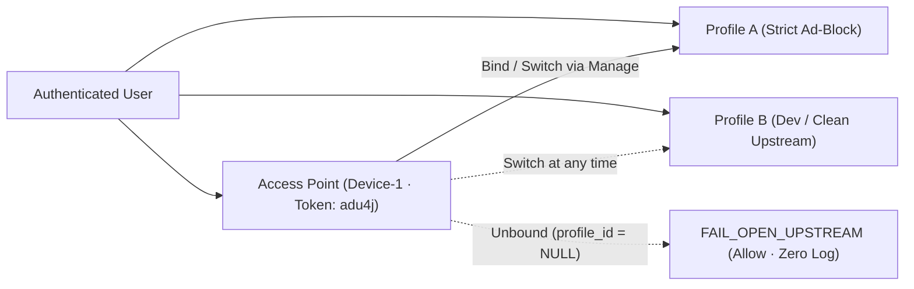

import { Image } from 'astro:assets';
import endpointsImg from '../../../../screenshots/dns_worker-endpoints.webp';
import profileSelectImg from '../../../../screenshots/dns_worker-profile_select.webp';
import setupImg from '../../../../screenshots/dns_worker-setup.webp';

DNS Worker separates **device endpoint credentials** from **DNS filtering policies** using a two-layer decoupled model:

- **Access Points (APs)**: User-owned device endpoints (e.g., `Phone-Mobile`, `Living-Room-Router`, `Laptop`). Each Access Point has its own independent routing token (`access_points.token`) and DoH/DoT URL. Because Access Points belong to your account rather than a single Profile, you can **switch or unbind** which Profile an Access Point uses at any time without reconfiguring the client device.
- **Profiles**: Isolated DNS policy domains defining custom rules, external blocklists, upstream resolvers, block mode, ECS/ECH options, and log retention settings.
- **Unbound Access Point → `FAIL_OPEN`**: If an Access Point is currently unbound (`profile_id = null`—for instance, newly created without a Profile or left behind after a Profile is deleted), DNS queries arriving on its token do **not** break client connectivity; instead, they fall back cleanly to `FAIL_OPEN_UPSTREAM` with no profile filtering rules applied and zero query logging.



---

## 1. Navigation Layout & Workflow

After signing in, the Web Dashboard lands on **Access Points → Setup** (`/access-points/setup`) by default and organizes navigation into three sidebar groups:

1. **Access Points**:
   - **Manage** (`/access-points/manage`): Search, create, rename, rotate tokens, delete, and **bind / switch / unbind** the Profile used by each Access Point.
   - **Setup** (`/access-points/setup`): Verify live connection status, select an Access Point via the dropdown switcher, inspect its DoH URL, and follow OS-specific setup guides.
2. **Profiles**:
   - **Collections** (`/dash`): Manage your DNS Profiles (create, import, rename, select, or delete).
   - **Analytics**, **Logs**, **Rules**, **Filters**, **Settings**: Inspect analytics, logs, and policies for the active Profile. Clicking any of these when no Profile is active automatically selects the Profile if you only have one, or opens **Collections** so you can pick one. While inside `/dash*` pages, the top header displays the active Profile name with a quick switcher dropdown.
3. **Preferences**:
   - **Account**, **System** (administrators only), and **Log out**.

---

## 2. Managing Access Points & Binding Profiles

<Image src={endpointsImg} alt="Access Points Management" format="webp" />

### Step 1: Create or Manage Access Points (`/access-points/manage`)
1. Open your DNS Worker Web Dashboard and log in.
2. In the left sidebar under **Access Points**, select **Manage**.
3. Click **+ Add Access Point**, enter a device name (e.g., `Phone-Mobile`, `Office-Laptop`), and optionally choose an initial **Bound Profile** (or leave it unbound).
4. Each new Access Point is assigned a unique routing token (e.g., `adu4j`) and a DoH URL (`https://<domain>/<token>`).

### Step 2: Switch or Unbind a Profile Dynamically
- On any Access Point card in **Manage**, use the **Bound Profile** selector to switch the device to another Profile—or set it to **Unbound** (`FAIL_OPEN`).
- Switching takes effect immediately across L1/L2 caches, Serverfull cluster workers, and Cloudflare Durable Objects without modifying the URL or `.mobileconfig` installed on your device.
- Deleting a Profile does **not** delete your Access Points; any Access Point that was bound to the deleted Profile is preserved cleanly with `Unbound` status (`FAIL_OPEN`).

### Step 3: Manage & Rename Profiles (`/dash`)
Open **Profiles → Collections** (`/dash`) to create, import, rename, select, or delete Profiles:

<Image src={profileSelectImg} alt="Profile Collections & Switcher" format="webp" />

---

## 3. Protocol Matrix & Endpoint Formats

DNS Worker supports all major encrypted DNS transports alongside classic UDP DNS:

| Protocol | Endpoint Format | Applicable Environments |
| :--- | :--- | :--- |
| **DoH (DNS over HTTPS)** | `https://<domain>/<accessKey>` | HTTP/2 & HTTP/3 compatible; Browsers, Windows 11, iOS/macOS profiles, `curl` |
| **DoT (DNS over TLS)** | `tls://<accessKey>.<dotDomain>:853` | DoQ (RFC 9250) compatible; Linux `systemd-resolved`, Stubby, Android Private DNS |
| **Android Private DNS** | `<accessKey>.<dotDomain>` | Android 9+ native Private DNS |
| **Classic UDP (Do53)** | `udp://<server-ip>:53` | Legacy routers, IoT devices, local testing (uses `defaultProfile` or `FAIL_OPEN`) |

> [!NOTE]
> `<accessKey>` prefers your **Access Point token** (`access_points.token`) so queries can be attributed to individual devices in logs and analytics while dynamically following whichever Profile the Access Point is bound to. Profile-level keys (`profiles.profile_key` / `profiles.id`) remain supported for direct routing.
>
> In Serverfull mode, DoT routing extracts `<accessKey>` from **TLS Server Name Indication (SNI)** during the ClientHello before decrypting DNS payloads.

---

## 4. Client Setup Guide (`/access-points/setup`)

The **Access Points → Setup** view provides live connection diagnostics (`Verify Your Connection`), an Access Point dropdown switcher, the active **Access DoH URL**, an unbound `FAIL_OPEN` notice when the selected Access Point has no bound Profile, and step-by-step OS guides:

<Image src={setupImg} alt="Interactive Client Setup Guide" format="webp" />

### Android 9+ (Native Private DNS)
1. Open **Settings** → **Network & Internet** → **Private DNS**.
2. Select **Private DNS provider hostname**.
3. Enter your Access Point hostname:
   ```text
   <accessKey>.<dotDomain>
   ```
   *Example:* `adu4j.dns.example.com`
4. Tap **Save**.

---

### Apple iOS / iPadOS / macOS

Apple operating systems natively support Encrypted DNS (DoH and DoT) through configuration profiles (`.mobileconfig`).

#### Method A: Web UI Mobileconfig Download
1. Open **Access Points → Setup** and choose the target Access Point from the dropdown.
2. Select the **Apple** tab (displays the selected **Access Point name** and DoH URL).
3. Click **Download Profile** to download the `.mobileconfig` file tailored to that Access Point.
4. Go to **Settings** → **Profile Downloaded** and tap **Install**.

#### Method B: Manual App Integration
In **AdGuard**, **DNSCloak**, or **Shadowrocket**:
- Select upstream type **DNS-over-HTTPS**.
- Enter your Access Point DoH URL: `https://<domain>/<accessKey>`.

---

### Windows 11 (Native DoH)

1. Open **Settings** (`Win + I`) → **Network & Internet** and select **Wi-Fi** or **Ethernet**.
2. Under **DNS server assignment**, click **Edit**, switch to **Manual**, and enable **IPv4**.
3. In **Preferred DNS**, enter your DNS Worker server IP (or local loopback/proxy IP).
4. Turn on **DNS over HTTPS** (`On (manual template)`) and paste your Access Point DoH template:
   ```text
   https://<domain>/<accessKey>
   ```
5. Click **Save**.

---

### Linux (`systemd-resolved`)

1. Edit `/etc/systemd/resolved.conf`:
   ```ini
   [Resolve]
   DNS=<server-ip>#<accessKey>.<dotDomain>
   DNSOverTLS=yes
   Domains=~.
   ```
2. Restart `systemd-resolved`:
   ```bash
   sudo systemctl restart systemd-resolved
   ```
3. Verify encryption status with `resolvectl status`.

---

### Routers & Gateways (OpenWrt / AdGuard Home)

In AdGuard Home **Settings** → **DNS Settings** → **Upstream DNS servers**, add your Access Point endpoints:
```text
tls://<accessKey>.<dotDomain>
https://<domain>/<accessKey>
```
