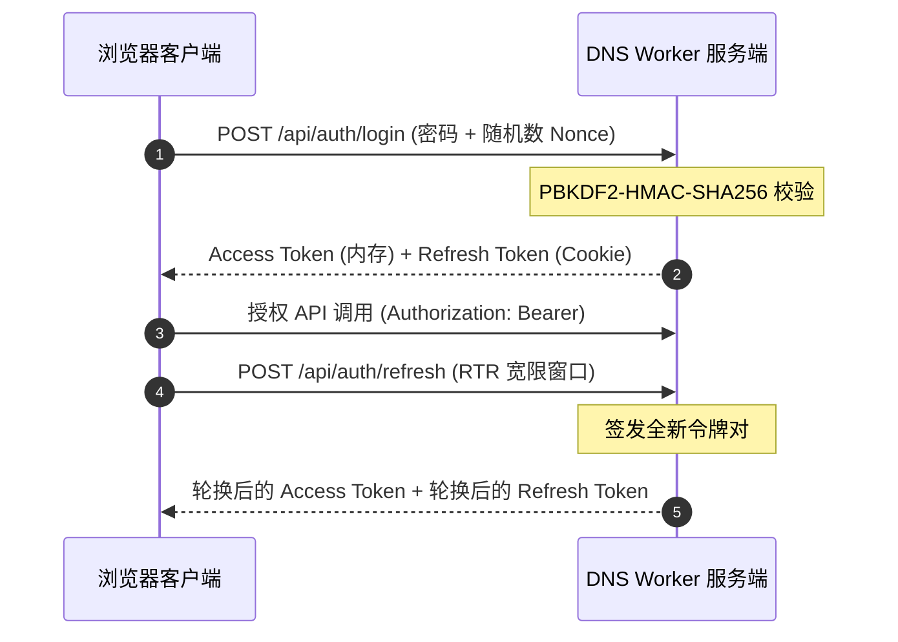
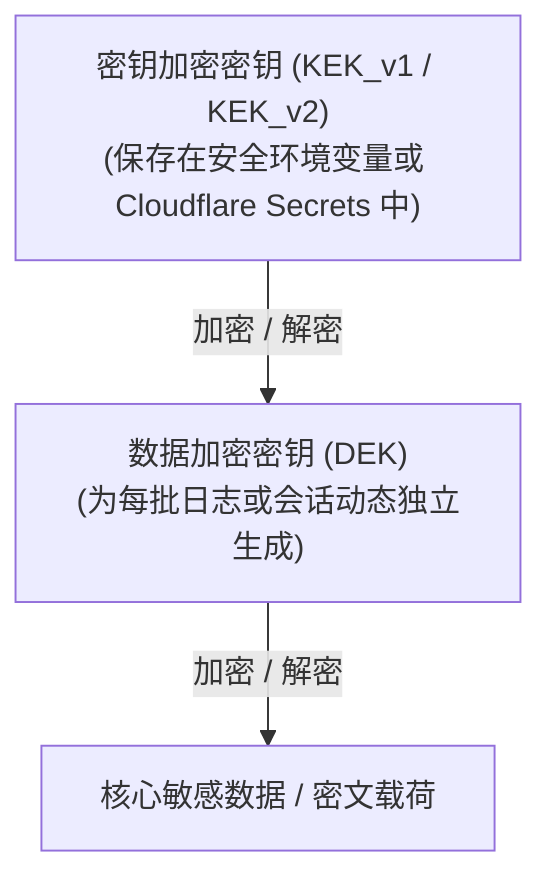

import { Image } from 'astro:assets';
import { Aside } from '@astrojs/starlight/components';
import loginImg from '../../../../../screenshots/dns_worker-login.webp';
import mfaImg from '../../../../../screenshots/dns_worker-mfa.webp';

DNS Worker 在后台解析管道与 Web 控制面板中全面践行零信任深度防御安全标准。本篇全面解析身份鉴权协议、信封密钥轮换机制以及核心安全环境变量。

---

## 1. Web 控制面板零信任身份鉴权

<Image src={loginImg} alt="Web 控制面板生物识别通行密钥登录" format="webp" />

Web 管理面板采用零信任身份认证与令牌轮换架构：



### 核心安全防线
- **硬件通行密钥 (WebAuthn)**：支持 Touch ID、Face ID、Windows Hello 及 YubiKey 生物认证，彻底阻断撞库与钓鱼攻击。
- **随机数防重放**：所有敏感操作均包含加密随机数，杜绝重放攻击。
- **非可导出 Web Crypto 密钥**：前端私钥运算（如后量子 ML-KEM、AES-GCM 日志解密）在独立 Web Worker 中使用不可导出的 Web Crypto API 原生对象执行。
- **单次刷新令牌轮换 (RTR)**：Refresh Token 具备一次性属性，每次换发新 Token 时旧 Token 立即吊销。
- **并发宽限窗口**：在多浏览器标签页并发请求时，通过原子 15 秒宽限期（`ROTATION_GRACE_PERIOD_SECONDS = 15`）避免误判登出。

---

## 2. 信封加密 (DEK / KEK) 架构

在 **Account & Security Settings**（账户与安全设置）卡片中管理主密钥、通行密钥及后量子 E2EE：

<Image src={mfaImg} alt="账户安全设置：多因素认证、通行密钥与后量子 E2EE" format="webp" />

服务端存储的敏感数据（包括用户会话令牌与加密查询日志）由两层信封加密机制保护：



### 无感平滑密钥轮换
1. 服务端自动加载最高版本的密钥（如 `KEK_v2`）加密所有新写入的数据。
2. 历史老数据仍可使用旧版 `KEK_v1` 或兼容的 `JWT_SECRET`（v0）无缝解密。
3. 伴随数据更新或定期维护任务，系统会自动将旧数据无缝重新加密至最新激活版本。

---

## 3. 安全环境变量速查

在 `.env`（Serverfull 模式）中配置，或在 Cloudflare Workers 中通过 `wrangler secret put <NAME>` 设置。

### `JWT_SECRET`
- **类型**：`string`（至少 32 字符）
- **职责**：令牌签名根密钥与 KEK_v0 信封加密基础后备。
- **安全要求**：必须使用高强度密码学伪随机数生成，严禁使用弱口令。
- **生成方式**：
  ```bash
  openssl rand -base64 32
  ```

### `KEK_v1`, `KEK_v2`, ...
- **类型**：`string`（至少 32 字符）
- **职责**：多版本信封加密主密钥。
- **配置范例**：
  ```ini
  KEK_v1=c3VwZXJzZWNyZXRrZXl2MWV4YW1wbGUxMjM0NTY3ODk=
  KEK_v2=bmV3ZXJzZWNyZXRrZXl2MmV4YW1wbGUxMjM0NTY3ODk=
  ```
  系统会自动识别数字最大的版本（`v2`）作为当前加密密钥，同时保留对旧版本的解密支持。

### `SERVERFULL_API_KEY`
- **类型**：`string`
- **职责**：独立服务器 API 管理令牌，以及 Cloudflare Worker 调用独立服务器时的鉴权凭据。
- **请求头**：`Authorization: Bearer <SERVERFULL_API_KEY>`。

### `ADMIN_PASSWORD`
- **类型**：`string`
- **职责**：初次部署时系统预设的管理员密码。初始化创建后凭据将安全加密存储于数据库中。

### `ACCESS_TOKEN_EXPIRATION_MINUTES`
- **类型**：`number`（默认：`10`）
- **职责**：Access JWT 令牌的有效期（分钟）。

### `SESSION_ABSOLUTE_MAX_MINUTES` / `OPTIONAL_SESSION_ABSOLUTE_MAX_DAYS`
- **类型**：`number`（默认：`1440` 分钟 / `7` 天）
- **职责**：分别限制标准会话（`s_`）与 Keep Logged In 持久会话（`k_`）自 `created_at` 起的不可逾越绝对有效期上限，确保即便持续活跃也需定期重新认证。

---

<Aside type="note" title="标准符合性与合规声明">
关于 **NIST SP 800-63B-4 (AAL2)** 等正式技术标准符合性声明，请参阅同章节的 [合规声明](/DNS-Worker/zh-cn/advanced/compliance/)。
</Aside>
