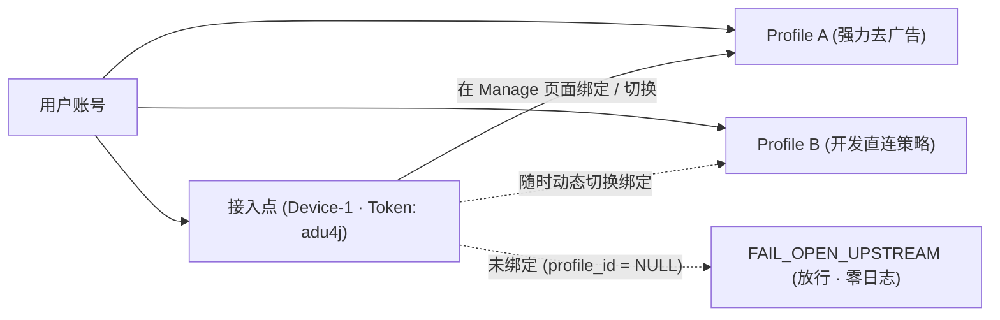

import { Image } from 'astro:assets';
import endpointsImg from '../../../../../screenshots/dns.obex-endpoints.webp';
import profileSelectImg from '../../../../../screenshots/dns.obex-profile_select.webp';
import setupImg from '../../../../../screenshots/dns.obex-setup.webp';

DNS Worker 采用**接入点与策略配置解耦**的双层架构，将“设备身份凭证”与“DNS 过滤策略”彻底分离：

- **接入点（Access Points）**：归属于用户账号名下（`owner_id`）的设备级访问凭证（例如 `Phone-Mobile`、`Living-Room-Router`、`Laptop`）。每个接入点拥有独立的 Token（`access_points.token`）与专属 DoH / DoT 地址。您可以在控制台**随时切换或解绑**任意接入点所绑定的 Profile，而**无需修改客户端设备上的任何配置**。
- **策略配置（Profiles）**：相互隔离的安全策略域，独立管理自定义规则、外部过滤列表订阅、上游解析器、拦截响应模式、ECS/ECH 选项及日志留存天数。
- **未绑定 Profile 自动回退 `FAIL_OPEN`**：当某个接入点处于未绑定状态（`profile_id = null`，例如新建未绑定或原绑定 Profile 被删除后保留）时，通过该接入点 Token 发起的 DNS 查询不会中断用户联网，而是自动回退至 `FAIL_OPEN_UPSTREAM` 直接解析（不应用过滤规则且不记录查询日志）。



---

## 1. 控制台导航结构

登录后系统默认进入 **Access Points → Setup**（`/access-points/setup`）接入引导页，左侧边栏划分为三大分组：

1. **Access Points（接入点）**：
   - **Manage**（`/access-points/manage`）：集中搜索、创建、重命名、轮换密钥、删除接入点，以及**绑定 / 切换 / 解绑**其关联的 Profile，并提供一键跳转 Setup。
   - **Setup**（`/access-points/setup`）：查看连接连通性验证（`Verify Your Connection`）、使用下拉菜单切换待配置接入点、复制 Access DoH URL，以及按操作系统查看接入教程。
2. **Profiles（策略配置）**：
   - **Collections**（`/dash`）：创建、导入、**重命名**、选中或删除 DNS 策略配置（Profiles）。
   - **Analytics / Logs / Rules / Filters / Settings**：针对当前激活 Profile 进行分析、审计与规则配置。当未选中 Profile 时点击这些菜单，若用户仅拥有 1 个 Profile 会自动选中直达对应页面，否则跳转 **Collections** 供选择。仅在 `/dash*` 路径下，顶部栏左侧才展示当前 Profile 名称与快捷切换下拉菜单。
3. **Preferences（偏好设置）**：
   - **Account**、**System**（管理员可见）、**Log out**。

---

## 2. 管理接入点与切换 Profile 绑定

<Image src={endpointsImg} alt="接入点管理面板" format="webp" />

### 步骤 1：创建与管理接入点（`/access-points/manage`）
1. 打开 DNS Worker Web 控制面板并登录您的账号。
2. 在左侧导航栏 **Access Points** 分组下点击 **Manage**。
3. 点击右上角 **+ Add Access Point**，输入设备/场景名称（如 `Phone-Mobile`、`Office-Laptop`），并可选指定初始 **Bound Profile**（也可留空处于未绑定状态）。
4. 系统为每个接入点生成唯一的路由 Token（如 `adu4j`）以及对应的 DoH 地址 `https://<domain>/<token>`。

### 步骤 2：动态切换或解绑 Profile
- 在 **Manage** 页面的任意接入点卡片上，通过 **Bound Profile** 下拉框即可随时切换该接入点所生效的 Profile，或切换为 **Unbound**（自动回退至 `FAIL_OPEN`）。
- 切换操作会同步失效 L1/L2 内存缓存、Serverfull 多进程集群缓存及 Cloudflare Durable Objects 注册表，秒级生效，客户端设备无需重新导入配置或更换 URL。
- 删除某个 Profile 时，系统**不会级联删除**接入点本身，原绑定至该 Profile 的接入点将被保留并安全置为未绑定状态（`profile_id = NULL`）。

### 步骤 3：管理与重命名 Profile（`/dash`）
进入 **Profiles → Collections**（`/dash`）可创建、导入、**重命名**、选中或删除各类 Profile 策略配置：

<Image src={profileSelectImg} alt="配置集合与切换" format="webp" />

---

## 3. 协议支持与接入 URL 矩阵

DNS Worker 支持主流现代加密 DNS 协议与传统 UDP DNS：

| 协议 | 接入地址格式 | 适用场景 |
| :--- | :--- | :--- |
| **DoH (DNS over HTTPS)** | `https://<domain>/<accessKey>` | 兼容 HTTP/2 与 HTTP/3，适用于浏览器、Windows 11、Apple 描述文件、`curl` |
| **DoT (DNS over TLS)** | `tls://<accessKey>.<dotDomain>:853` | 兼容 DoQ (RFC 9250)，适用于 Linux `systemd-resolved`、Stubby、Android 私有 DNS |
| **Android 私有 DNS** | `<accessKey>.<dotDomain>` | Android 9+ 系统自带私有 DNS |
| **传统 UDP (Do53)** | `udp://<server-ip>:53` | 传统路由器、IoT 设备、局域网测试（使用默认 Profile 或 `FAIL_OPEN`） |

> [!NOTE]
> `<accessKey>` 优先匹配 **Access Point Token**（`access_points.token`），用于在日志与分析中精确区分来源设备并按实时绑定关系路由至对应 Profile（未绑定时回退 `FAIL_OPEN`）；同时继续兼容直接使用 `profiles.profile_key` 或 `profiles.id` 进行路由。
>
> 在 Serverfull 模式下，DoT 接入路由依赖 **TLS 服务器名称指示（SNI）**，服务端在解密请求包之前即可从 ClientHello 提取 `<accessKey>` 子域名完成分流。

---

## 4. 客户端交互式配置引导（`/access-points/setup`）

进入 **Access Points → Setup** 页即可使用连通性检测卡片、顶部风格的接入点下拉切换器、Access DoH URL 展示框（若所选 AP 未绑定 Profile 会显示 `FAIL_OPEN` 状态提示）以及各平台一键配置向导：

<Image src={setupImg} alt="客户端交互式配置引导" format="webp" />

### Android 9+（原生私有 DNS）
1. 打开 Android 设备 **设置** → **网络和互联网** → **私有 DNS**。
2. 选择 **私有 DNS 提供商主机名**。
3. 填入接入点主机名：
   ```text
   <accessKey>.<dotDomain>
   ```
   *示例：* `adu4j.dns.example.com`
4. 点击 **保存**。

---

### Apple iOS / iPadOS / macOS

Apple 生态系统通过描述文件（`.mobileconfig`）原生支持加密 DNS（DoH 与 DoT）。

#### 方式 A：直接下载移动配置文件 (.mobileconfig)
1. 在 **Access Points → Setup** 页面顶部卡片选中目标接入点。
2. 切换到 **Apple** 标签页（卡片中会展示当前接入点名称与对应的 DoH URL）。
3. 点击 **Download Profile** 下载专属 `.mobileconfig` 描述文件。
4. 在 Apple 设备前往 **设置** → **已下载描述文件**，点击 **安装** 即可。

#### 方式 B：第三方工具集成
亦可在 **AdGuard**、**DNSCloak** 或 **Shadowrocket** 中配置：
- 上游类型选择 **DNS-over-HTTPS**。
- 填入接入点 DoH 地址：`https://<domain>/<accessKey>`。

---

### Windows 11（原生 DoH）

1. 打开 **设置** (`Win + I`) → **网络和 Internet**，选择 **Wi-Fi** 或 **以太网**。
2. 在 **DNS 服务器分配** 处点击 **编辑**，切换为 **手动** 并启用 **IPv4**。
3. 在 **首选 DNS** 中输入服务器 IP。
4. 启用 **DNS over HTTPS**（**开（手动模板）**），并填入当前接入点 DoH 模板：
   ```text
   https://<domain>/<accessKey>
   ```
5. 点击 **保存**。

---

### Linux (`systemd-resolved`)

1. 编辑 `/etc/systemd/resolved.conf`：
   ```ini
   [Resolve]
   DNS=<server-ip>#<accessKey>.<dotDomain>
   DNSOverTLS=yes
   Domains=~.
   ```
2. 重启服务并验证：
   ```bash
   sudo systemctl restart systemd-resolved
   resolvectl status
   ```

---

### 路由器与网关设备 (OpenWrt / AdGuard Home)

在 AdGuard Home **设置** → **DNS 设置** → **上游 DNS 服务器** 中填入接入点地址：
```text
tls://<accessKey>.<dotDomain>
https://<domain>/<accessKey>
```
