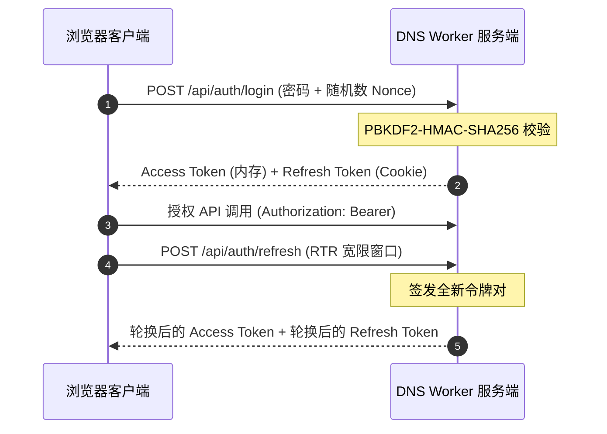
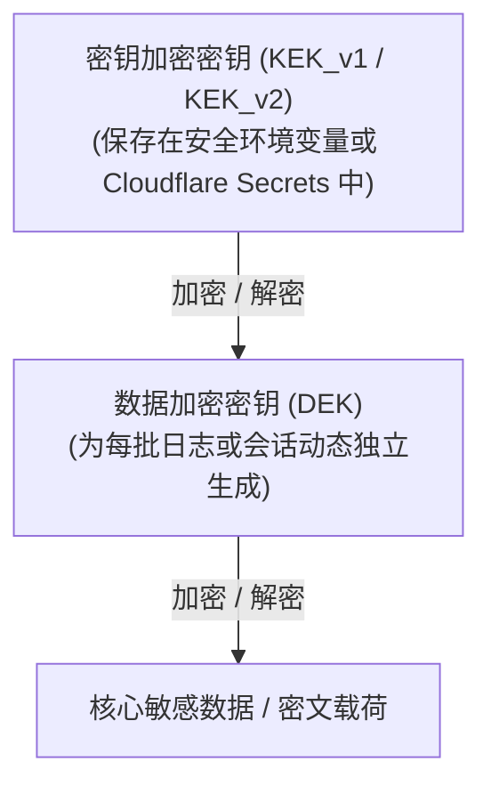

import { Image } from 'astro:assets';
import { Aside } from '@astrojs/starlight/components';
import loginImg from '../../../../../screenshots/dns_worker-login.webp';
import mfaImg from '../../../../../screenshots/dns_worker-mfa.webp';

DNS Worker 在後臺解析管道與 Web 控制面板中全面踐行零信任深度防禦安全標準。本篇全面解析身份鑑權協議、信封金鑰輪換機制以及核心安全環境變數。

---

## 1. Web 控制面板零信任身份鑑權

<Image src={loginImg} alt="Web 控制面板生物識別通行金鑰登入" format="webp" />

Web 管理面板採用零信任身份認證與令牌輪換架構：



### 核心安全防線
- **硬體通行金鑰 (WebAuthn)**：支援 Touch ID、Face ID、Windows Hello 及 YubiKey 生物認證，徹底阻斷撞庫與釣魚攻擊。
- **隨機數防重放**：所有敏感操作均包含加密隨機數，杜絕重放攻擊。
- **非可匯出 Web Crypto 金鑰**：前端私鑰運算（如後量子 ML-KEM、AES-GCM 日誌解密）在獨立 Web Worker 中使用不可匯出的 Web Crypto API 原生物件執行。
- **單次重新整理令牌輪換 (RTR)**：Refresh Token 具備一次性屬性，每次換髮新 Token 時舊 Token 立即吊銷。
- **併發寬限視窗**：在多瀏覽器標籤頁併發請求時，通過原子 15 秒寬限期（`ROTATION_GRACE_PERIOD_SECONDS = 15`）避免誤判登出。

---

## 2. 信封加密 (DEK / KEK) 架構

在 **Account & Security Settings**（賬戶與安全設定）卡片中管理主金鑰、通行金鑰及後量子 E2EE：

<Image src={mfaImg} alt="賬戶安全設定：多因素認證、通行金鑰與後量子 E2EE" format="webp" />

服務端儲存的敏感資料（包括使用者會話令牌與加密查詢日誌）由兩層信封加密機制保護：



### 無感平滑金鑰輪換
1. 服務端自動載入最高版本的金鑰（如 `KEK_v2`）加密所有新寫入的資料。
2. 歷史老資料仍可使用舊版 `KEK_v1` 或相容的 `JWT_SECRET`（v0）無縫解密。
3. 伴隨資料更新或定期維護任務，系統會自動將舊資料無縫重新加密至最新啟用版本。

---

## 3. 安全環境變數速查

在 `.env`（Serverfull 模式）中配置，或在 Cloudflare Workers 中通過 `wrangler secret put <NAME>` 設定。

### `JWT_SECRET`
- **型別**：`string`（至少 32 字元）
- **職責**：令牌簽名根金鑰與 KEK_v0 信封加密基礎後備。
- **安全要求**：必須使用高強度密碼學偽隨機數生成，嚴禁使用弱口令。
- **生成方式**：
  ```bash
  openssl rand -base64 32
  ```

### `KEK_v1`, `KEK_v2`, ...
- **型別**：`string`（至少 32 字元）
- **職責**：多版本信封加密主金鑰。
- **配置範例**：
  ```ini
  KEK_v1=c3VwZXJzZWNyZXRrZXl2MWV4YW1wbGUxMjM0NTY3ODk=
  KEK_v2=bmV3ZXJzZWNyZXRrZXl2MmV4YW1wbGUxMjM0NTY3ODk=
  ```
  系統會自動識別數字最大的版本（`v2`）作為當前加密金鑰，同時保留對舊版本的解密支援。

### `SERVERFULL_API_KEY`
- **型別**：`string`
- **職責**：獨立伺服器 API 管理令牌，以及 Cloudflare Worker 呼叫獨立伺服器時的鑑權憑據。
- **請求頭**：`Authorization: Bearer <SERVERFULL_API_KEY>`。

### `ADMIN_PASSWORD`
- **型別**：`string`
- **職責**：初次部署時系統預設的管理員密碼。初始化建立後憑據將安全加密儲存於資料庫中。

### `ACCESS_TOKEN_EXPIRATION_MINUTES`
- **型別**：`number`（預設：`10`）
- **職責**：Access JWT 令牌的有效期（分鐘）。

### `SESSION_ABSOLUTE_MAX_MINUTES` / `OPTIONAL_SESSION_ABSOLUTE_MAX_DAYS`
- **型別**：`number`（預設：`1440` 分鐘 / `7` 天）
- **職責**：分別限制標準會話（`s_`）與 Keep Logged In 持久會話（`k_`）自 `created_at` 起的不可逾越絕對有效期上限，確保即便持續活躍也需定期重新認證。

---

<Aside type="note" title="標準符合性與合規宣告">
關於 **NIST SP 800-63B-4 (AAL2)** 等正式技術標準符合性宣告，請參閱同章節的 [合規宣告](/DNS-Worker/zh-tw/advanced/compliance/)。
</Aside>
