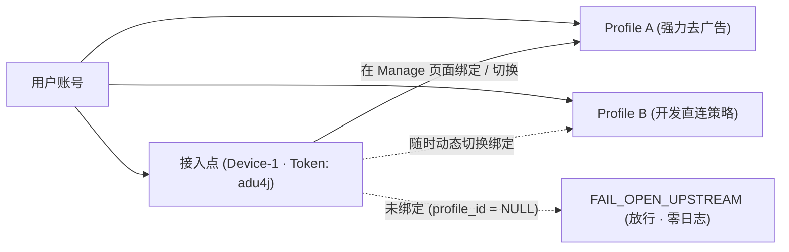

import { Image } from 'astro:assets';
import endpointsImg from '../../../../../screenshots/dns.obex-endpoints.webp';
import profileSelectImg from '../../../../../screenshots/dns.obex-profile_select.webp';
import setupImg from '../../../../../screenshots/dns.obex-setup.webp';

DNS Worker 採用**接入點與策略配置解耦**的雙層架構，將“裝置身份憑證”與“DNS 過濾策略”徹底分離：

- **接入點（Access Points）**：歸屬於使用者賬號名下（`owner_id`）的裝置級訪問憑證（例如 `Phone-Mobile`、`Living-Room-Router`、`Laptop`）。每個接入點擁有獨立的 Token（`access_points.token`）與專屬 DoH / DoT 地址。您可以在控制台**隨時切換或解綁**任意接入點所繫結的 Profile，而**無需修改客戶端裝置上的任何配置**。
- **策略配置（Profiles）**：相互隔離的安全策略域，獨立管理自定義規則、外部過濾列表訂閱、上游解析器、攔截響應模式、ECS/ECH 選項及日誌留存天數。
- **未繫結 Profile 自動回退 `FAIL_OPEN`**：當某個接入點處於未繫結狀態（`profile_id = null`，例如新建未繫結或原繫結 Profile 被刪除後保留）時，通過該接入點 Token 發起的 DNS 查詢不會中斷使用者聯網，而是自動回退至 `FAIL_OPEN_UPSTREAM` 直接解析（不應用過濾規則且不記錄查詢日誌）。



---

## 1. 控制台導航結構

登入後系統預設進入 **Access Points → Setup**（`/access-points/setup`）接入引導頁，左側邊欄劃分為三大分組：

1. **Access Points（接入點）**：
   - **Manage**（`/access-points/manage`）：集中搜索、建立、重新命名、輪換金鑰、刪除接入點，以及**繫結 / 切換 / 解綁**其關聯的 Profile，並提供一鍵跳轉 Setup。
   - **Setup**（`/access-points/setup`）：檢視連線連通性驗證（`Verify Your Connection`）、使用下拉選單切換待配置接入點、複製 Access DoH URL，以及按作業系統檢視接入教程。
2. **Profiles（策略配置）**：
   - **Collections**（`/dash`）：建立、匯入、**重新命名**、選中或刪除 DNS 策略配置（Profiles）。
   - **Analytics / Logs / Rules / Filters / Settings**：針對當前啟用 Profile 進行分析、審計與規則配置。當未選中 Profile 時點選這些選單，若使用者僅擁有 1 個 Profile 會自動選中直達對應頁面，否則跳轉 **Collections** 供選擇。僅在 `/dash*` 路徑下，頂部欄左側才展示當前 Profile 名稱與快捷切換下拉選單。
3. **Preferences（偏好設定）**：
   - **Account**、**System**（管理員可見）、**Log out**。

---

## 2. 管理接入點與切換 Profile 繫結

<Image src={endpointsImg} alt="接入點管理面板" format="webp" />

### 步驟 1：建立與管理接入點（`/access-points/manage`）
1. 開啟 DNS Worker Web 控制面板並登入您的賬號。
2. 在左側導航欄 **Access Points** 分組下點選 **Manage**。
3. 點選右上角 **+ Add Access Point**，輸入裝置/場景名稱（如 `Phone-Mobile`、`Office-Laptop`），並可選指定初始 **Bound Profile**（也可留空處於未繫結狀態）。
4. 系統為每個接入點生成唯一的路由 Token（如 `adu4j`）以及對應的 DoH 地址 `https://<domain>/<token>`。

### 步驟 2：動態切換或解綁 Profile
- 在 **Manage** 頁面的任意接入點卡片上，通過 **Bound Profile** 下拉框即可隨時切換該接入點所生效的 Profile，或切換為 **Unbound**（自動回退至 `FAIL_OPEN`）。
- 切換操作會同步失效 L1/L2 記憶體快取、Serverfull 多程序叢集快取及 Cloudflare Durable Objects 登錄檔，秒級生效，客戶端裝置無需重新匯入配置或更換 URL。
- 刪除某個 Profile 時，系統**不會級聯刪除**接入點本身，原繫結至該 Profile 的接入點將被保留並安全置為未繫結狀態（`profile_id = NULL`）。

### 步驟 3：管理與重新命名 Profile（`/dash`）
進入 **Profiles → Collections**（`/dash`）可建立、匯入、**重新命名**、選中或刪除各類 Profile 策略配置：

<Image src={profileSelectImg} alt="配置集合與切換" format="webp" />

---

## 3. 協議支援與接入 URL 矩陣

DNS Worker 支援主流現代加密 DNS 協議與傳統 UDP DNS：

| 協議 | 接入地址格式 | 適用場景 |
| :--- | :--- | :--- |
| **DoH (DNS over HTTPS)** | `https://<domain>/<accessKey>` | 相容 HTTP/2 與 HTTP/3，適用於瀏覽器、Windows 11、Apple 描述檔案、`curl` |
| **DoT (DNS over TLS)** | `tls://<accessKey>.<dotDomain>:853` | 相容 DoQ (RFC 9250)，適用於 Linux `systemd-resolved`、Stubby、Android 私有 DNS |
| **Android 私有 DNS** | `<accessKey>.<dotDomain>` | Android 9+ 系統自帶私有 DNS |
| **傳統 UDP (Do53)** | `udp://<server-ip>:53` | 傳統路由器、IoT 裝置、區域網測試（使用預設 Profile 或 `FAIL_OPEN`） |

> [!NOTE]
> `<accessKey>` 優先匹配 **Access Point Token**（`access_points.token`），用於在日誌與分析中精確區分來源裝置並按即時繫結關係路由至對應 Profile（未繫結時回退 `FAIL_OPEN`）；同時繼續相容直接使用 `profiles.profile_key` 或 `profiles.id` 進行路由。
>
> 在 Serverfull 模式下，DoT 接入路由依賴 **TLS 伺服器名稱指示（SNI）**，服務端在解密請求包之前即可從 ClientHello 提取 `<accessKey>` 子域名完成分流。

---

## 4. 客戶端互動式配置引導（`/access-points/setup`）

進入 **Access Points → Setup** 頁即可使用連通性檢測卡片、頂部風格的接入點下拉切換器、Access DoH URL 展示框（若所選 AP 未繫結 Profile 會顯示 `FAIL_OPEN` 狀態提示）以及各平臺一鍵配置嚮導：

<Image src={setupImg} alt="客戶端互動式配置引導" format="webp" />

### Android 9+（原生私有 DNS）
1. 開啟 Android 裝置 **設定** → **網路和網際網路** → **私有 DNS**。
2. 選擇 **私有 DNS 提供商主機名**。
3. 填入接入點主機名：
   ```text
   <accessKey>.<dotDomain>
   ```
   *示例：* `adu4j.dns.example.com`
4. 點選 **儲存**。

---

### Apple iOS / iPadOS / macOS

Apple 生態系統通過描述檔案（`.mobileconfig`）原生支援加密 DNS（DoH 與 DoT）。

#### 方式 A：直接下載移動配置檔案 (.mobileconfig)
1. 在 **Access Points → Setup** 頁面頂部卡片選中目標接入點。
2. 切換到 **Apple** 標籤頁（卡片中會展示當前接入點名稱與對應的 DoH URL）。
3. 點選 **Download Profile** 下載專屬 `.mobileconfig` 描述檔案。
4. 在 Apple 裝置前往 **設定** → **已下載描述檔案**，點選 **安裝** 即可。

#### 方式 B：第三方工具整合
亦可在 **AdGuard**、**DNSCloak** 或 **Shadowrocket** 中配置：
- 上游型別選擇 **DNS-over-HTTPS**。
- 填入接入點 DoH 地址：`https://<domain>/<accessKey>`。

---

### Windows 11（原生 DoH）

1. 開啟 **設定** (`Win + I`) → **網路和 Internet**，選擇 **Wi-Fi** 或 **乙太網路**。
2. 在 **DNS 伺服器分配** 處點選 **編輯**，切換為 **手動** 並啟用 **IPv4**。
3. 在 **首選 DNS** 中輸入伺服器 IP。
4. 啟用 **DNS over HTTPS**（**開（手動模板）**），並填入當前接入點 DoH 模板：
   ```text
   https://<domain>/<accessKey>
   ```
5. 點選 **儲存**。

---

### Linux (`systemd-resolved`)

1. 編輯 `/etc/systemd/resolved.conf`：
   ```ini
   [Resolve]
   DNS=<server-ip>#<accessKey>.<dotDomain>
   DNSOverTLS=yes
   Domains=~.
   ```
2. 重啟服務並驗證：
   ```bash
   sudo systemctl restart systemd-resolved
   resolvectl status
   ```

---

### 路由器與閘道器裝置 (OpenWrt / AdGuard Home)

在 AdGuard Home **設定** → **DNS 設定** → **上游 DNS 伺服器** 中填入接入點地址：
```text
tls://<accessKey>.<dotDomain>
https://<domain>/<accessKey>
```
